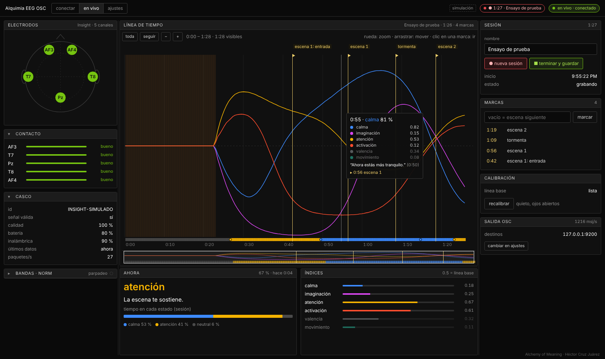
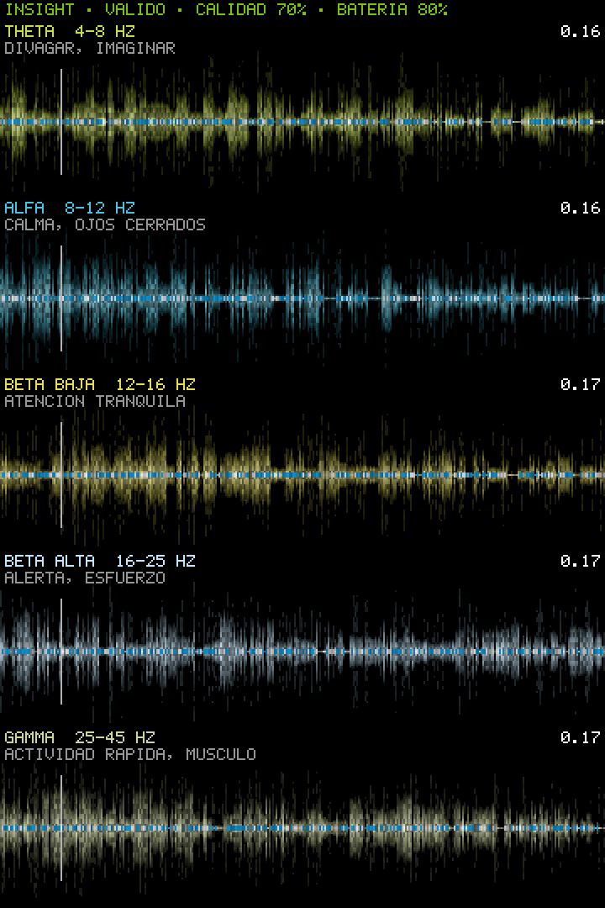
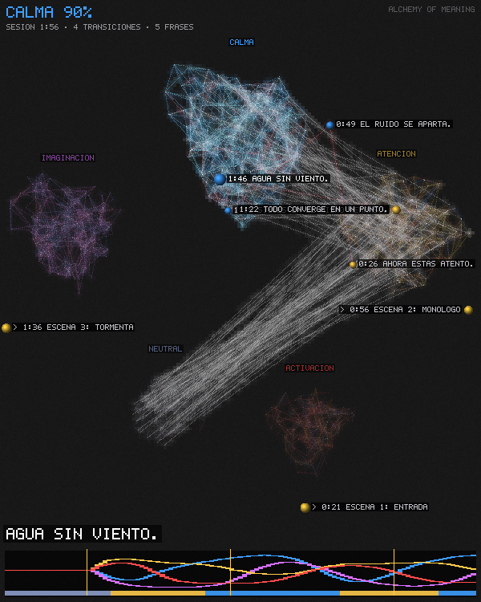
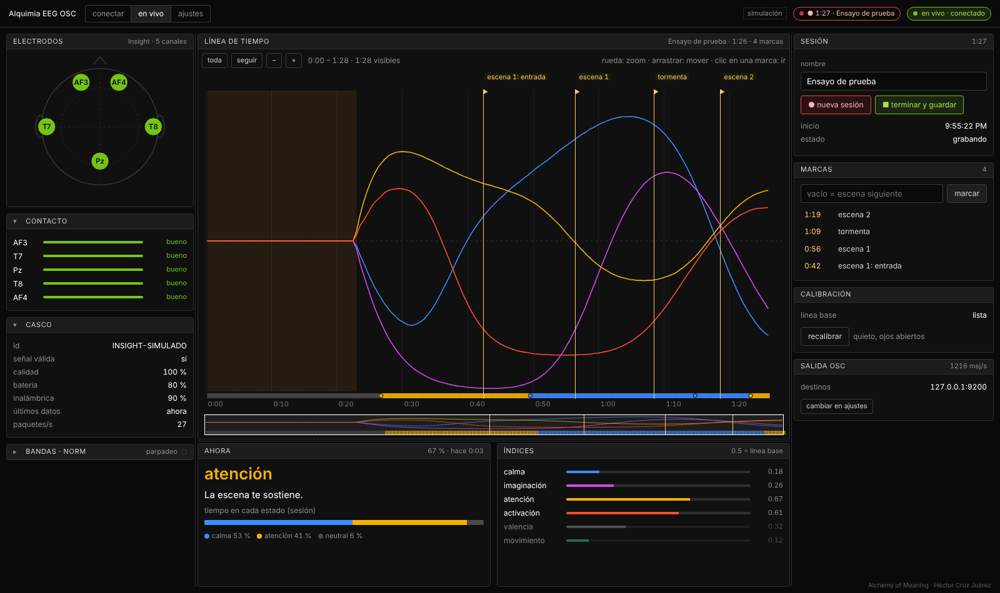
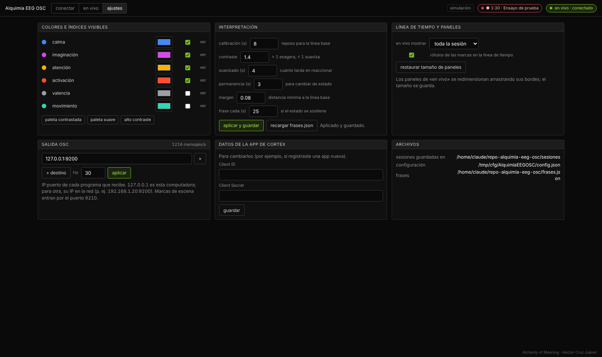
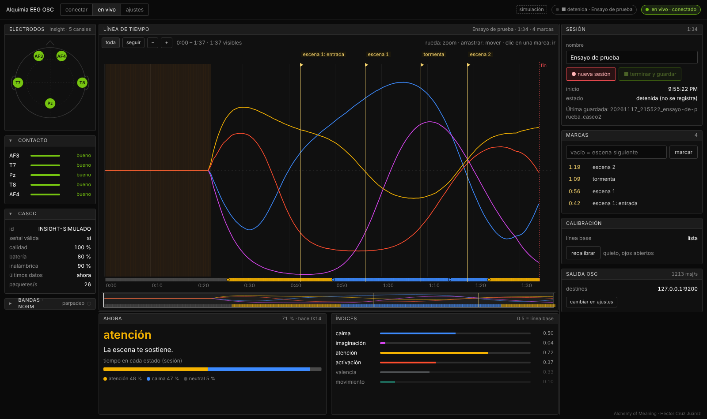
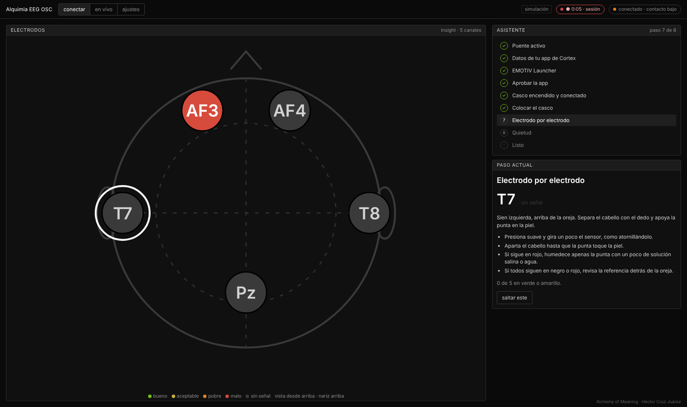

# Alquimia EEG OSC

**v0.6** · Puente entre cascos EEG Emotiv (Insight, EPOC+) y OSC para teatro, danza y música, con dashboard de sesiones.



*[English below](#english)*

## Qué es

Lee los datos de un casco Emotiv a través de **Cortex** (el servicio del EMOTIV Launcher): bandas de frecuencia, parpadeos y expresiones faciales, métricas de atención o relajación, giro de cabeza y calidad de contacto. Los suaviza, los normaliza de 0 a 1 y los envía por **OSC** a TouchDesigner, Isadora o cualquier programa que lo reciba.

Está pensado para escena: estados de un intérprete o de alguien del público que mueven un paisaje, una música o un cue, y también para grabar sesiones y analizar una obra escena por escena.

- **Monitor de contacto** en el navegador: la cabeza vista desde arriba, con cada electrodo en verde, amarillo, naranja, rojo o gris. Tiene un **asistente** paso a paso para colocar el casco y un **modo avanzado** con todos los datos.
- Salida a tasa fija, solo con números (sin texto), con `valid` y `quality` para saber cuándo confiar en la señal.
- Calibración automática por persona (`/norm`).
- Grabación y reproducción de sesiones, para ensayar sin casco y tener respaldo en función.
- Modo de simulación para armar el patch sin casco.

Especificación OSC completa: [docs/especificacion-osc.md](docs/especificacion-osc.md).

## Instalación paso a paso

### Opción A · Ejecutable (recomendado, sin instalar Python)

1. **EMOTIV Launcher:** descárgalo de https://www.emotiv.com/pages/download-emotiv-launcher (o en emotiv.com → My Account → Downloads → *Emotiv-Installer-Win*). Instálalo, ábrelo e inicia sesión con tu cuenta.
2. **Tu app de Cortex** (una sola vez): emotiv.com → **My Account → Cortex Apps → Register new**. Ponle nombre, deja **apagado** «Enable EEG for Professional devices» y registra. Guarda el **Client ID** y el **Client Secret**: el Secret solo se muestra una vez.
3. **Descarga el programa** desde **[Releases](https://github.com/loquellega/alquimia-eeg-osc/releases)**:
   - Windows: `AlquimiaEEGOSC-windows.exe`
   - Mac (Apple Silicon): `AlquimiaEEGOSC-mac.zip`
4. **Ábrelo con doble clic.** Se abre una ventana de texto (déjala abierta; es el puente) y el monitor en el navegador.
   - Windows puede avisar «Windows protegió su PC», porque el programa no está firmado: **Más información → Ejecutar de todas formas**.
   - Mac: clic derecho → **Abrir** la primera vez.
5. **En el monitor, pega el Client ID y el Client Secret** y pulsa *guardar*. Se guardan en tu computadora y no se vuelven a pedir.
6. **Aprueba la app** en el Launcher cuando lo pida (solo la primera vez).
7. Enciende el casco y **sigue el asistente** hasta que diga «Conectado. Listo para escena.»

Para cerrar, cierra la ventana de texto. Las grabaciones (`--grabar`) quedan junto al ejecutable.

### Opción B · Desde el código, con Python

1. **Python 3.12** de python.org. En Windows, marca **«Add python.exe to PATH»** al instalar. En Mac, usa `python3` y `pip3` en lugar de `python` y `pip`.
2. **Descarga el repo** (botón verde **Code → Download ZIP**) o clónalo: `git clone https://github.com/loquellega/alquimia-eeg-osc`
3. **Abre una terminal dentro de la carpeta** (en Windows: escribe `cmd` en la barra de direcciones de la carpeta; en Mac: clic derecho → *Nuevo Terminal en la carpeta*) y corre:
   ```
   pip install -r requirements.txt
   ```
4. Instala el **EMOTIV Launcher** y registra tu app de Cortex (pasos 1 y 2 de la opción A).
5. Prueba sin casco: `python cortex_osc.py --simular --monitor`
6. Con el casco: `python cortex_osc.py --monitor`. Pega tus datos en el monitor y sigue el asistente.

> Opcional: en lugar de escribirlos en el monitor, puedes poner `EMOTIV_CLIENT_ID` y `EMOTIV_CLIENT_SECRET` en un archivo `.env` (copia `.env.example`). El `.env` nunca se sube a GitHub.

### Dónde se guardan tus datos de Cortex
- Windows: `%APPDATA%\AlquimiaEEGOSC\config.json`
- Mac: `~/Library/Application Support/AlquimiaEEGOSC/config.json`
- Linux: `~/.config/AlquimiaEEGOSC/config.json`

Para cambiarlos, borra ese archivo y vuelve a abrir el programa.

## ¿Cómo sé que está conectado?

- En el monitor, la pastilla de arriba a la derecha dice **«en vivo · conectado»** en verde cuando todos los electrodos están en aceptable o bueno y la señal es confiable.
  - «en vivo · revisa contacto»: llegan datos, pero algún electrodo sigue en rojo o naranja.
  - «sin datos del casco» o «esperando Launcher»: falta un paso. El asistente te dice cuál.
- En TouchDesigner o Isadora, `/eeg/2/valid` vale **1** (o `/eeg/1/valid` con el EPOC+).
- En la terminal aparece «En vivo. Enviando OSC…».

## Dashboard

Se abre con `--monitor` (el ejecutable lo abre siempre) en `http://localhost:9201`. Tiene tres vistas (teclas 1, 2, 3):

### Conectar
El asistente paso a paso: datos de la app de Cortex → Launcher → aprobar la app → encender el casco → colocarlo → electrodo por electrodo (con el que falta marcado y pistas de dónde va) → quietud → listo. Se abre solo mientras falta algo y, en cuanto todo está listo, pasa a «en vivo».

Colores de contacto: **verde** bueno · **amarillo** aceptable · **naranja** pobre · **rojo** malo · **gris** sin señal. Desde amarillo ya cuenta como conectado.

### En vivo
- **Paneles redimensionables:** arrastra los bordes entre columnas y entre la línea de tiempo y la parte de abajo (doble clic en un borde lo restaura). El tamaño se guarda.
- **Izquierda:** electrodos en pequeño, contacto por canal, datos del casco y bandas.
- **Línea de tiempo** de toda la sesión:
  - curvas de los índices con sus colores, franja de estados abajo, puntos de cada frase, zona de calibración y tramos sin señal válida;
  - **marcas de escena** como banderas con su texto; clic en una para ir a ella;
  - **rueda** = zoom, **arrastrar** = mover, doble clic o **toda** = ver todo, **seguir** = acompañar en vivo;
  - al pasar el **puntero**: minuto, estado, todos los índices, la frase vigente y la marca cercana;
  - **minimapa** debajo con la sesión completa y el tramo visible.
- **Abajo:** el estado actual con su frase, el tiempo en cada estado durante la sesión y los índices.
- **Derecha:**
  - **sesión** con nombre, *● nueva sesión* (guarda la actual y empieza otra) y *■ terminar y guardar*;
  - **marcas** (tecla **M**; vacío = «escena siguiente», numerada sola) y lista clicable;
  - calibración y salida OSC.

Atajos: **M** marcar · **+ / −** zoom · **0** toda la sesión · **F** seguir en vivo.

### Ajustes
- **Colores** de cada índice (calma, imaginación, atención, activación, valencia, movimiento), cuáles se ven y tres paletas (contrastada, suave, alto contraste).
- **Interpretación:** calibración, contraste, suavizado, permanencia, margen y cada cuánto repetir frase.
- **Línea de tiempo:** ventana en vivo (toda la sesión o los últimos 1, 5, 10 o 30 min) y rótulos de marcas.
- **Salida OSC**, **datos de la app de Cortex** y dónde están los archivos (sesiones, configuración, frases).

Todo se guarda en la configuración y se conserva al volver a abrir.

## Uso diario

| Opción | Qué hace |
|---|---|
| `--monitor` | abre el monitor de contacto (`--no-abrir` para no abrir el navegador solo). El ejecutable lo abre siempre con doble clic |
| `--simular` | datos sintéticos sin casco |
| `--grabar` | guarda la sesión en `grabaciones/eeg_FECHA.jsonl` |
| `--reproducir ARCHIVO` | reproduce una grabación (`--bucle` para repetir) |
| `--destino host:puerto` | destino OSC; se puede repetir. Por defecto `127.0.0.1:9200` |
| `--crudo` | EEG crudo en `/eeg/{casco}/raw` (cascos de consumo como el Insight) |
| `--casco INSIGHT` | usa solo el casco cuyo id contenga ese texto |
| `--hz 30` · `--suavizado 0.3` | tasa de salida · suavizado (más bajo = más suave) |
| `--debito 10` | sesiones que se piden a Cortex al autorizar (evita el error -32019) |

Ejemplo, en función: `python cortex_osc.py --monitor --grabar --destino 127.0.0.1:9200 --destino 192.168.1.20:9200`

**Recibir:** en TouchDesigner usa un OSC In CHOP en el puerto 9200. En Isadora, pon el puerto OSC en 9200 (Preferencias → Comunicaciones) y usa el actor OSC Listener.

**Cascos:** `/eeg/1/…` = EPOC+, `/eeg/2/…` = Insight.

**Nota:** con Cortex sin licencia de pago, los cascos de consumo (Insight) entregan todos los flujos, incluido el EEG crudo; los profesionales (EPOC) todo excepto el EEG crudo y las métricas de alta resolución. El EEG no lee emociones: da estimaciones de estado. Úsalas como textura escénica, no como verdad.

## Interpretación, frases y sesión

Además de las bandas, el puente calcula unos pocos **índices** (0–1, donde 0.5 es la línea base de la persona) y un **estado** que solo cambia si se sostiene unos segundos:

| Índice | De dónde sale |
|---|---|
| `calma` | alfa relativa (más alfa que de costumbre) |
| `imaginacion` | theta frente a beta (mente que divaga) |
| `atencion` | índice de compromiso β/(α+θ) |
| `activacion` | beta alta y gamma frente a las bandas lentas |
| `valencia` | asimetría frontal alfa AF4–AF3 (acercamiento o retiro) |
| `movimiento` | velocidad del giro de la cabeza |

Son **interpretaciones**, no lectura de la mente: relaciones conocidas entre bandas, comparadas con la misma persona en reposo. Los electrodos con mal contacto se dejan fuera del cálculo.

- **Calibración:** los primeros 60 s con señal válida (quieto, ojos abiertos) son la línea base. Se puede repetir con *recalibrar*.
- **Exagerar o suavizar:** `contraste` (más de 1 exagera) y `permanencia` (segundos para cambiar de estado), en el monitor o con `--contraste` y `--permanencia`.
- **Frases:** `frases.json` es la librería que va eligiendo el narrador según el estado, su intensidad y las transiciones. Edítala con tu voz y déjala junto al ejecutable.
- **Sesión y marcas de escena:** cada segundo se registra todo. Las marcas llegan por OSC al puerto **9210** (`/eeg/marca "escena 2"`, desde Isadora, QLab o TouchDesigner) o desde el monitor. Al terminar (botón *terminar y guardar*, `/eeg/sesion/terminar` o al cerrar el puente) se guarda en `sesiones/` un `.json`, un `.csv` y un `.txt` con el relato:

```
0:32–0:49  atención (69%)  · La escena te sostiene.
  ▸ 0:41  marca: escena 1: entrada
0:49–1:12  calma (84%)  · Hay espacio entre un pensamiento y otro.
```

Salen por OSC como `/eeg/2/indice/{calma…}`, `/eeg/2/estado` (id, intensidad), `/eeg/2/estado/cambio`, `/eeg/2/frase` (texto) y `/eeg/2/sesion/{tiempo,calibracion}`. Ver la especificación.

## Visor para TouchDesigner

En `touchdesigner/eeg_visor_td.py` hay un componente listo para probar (TouchDesigner 2025):

1. Crea un **Text DAT**, pega el archivo y haz **clic derecho → Run Script**.
2. Aparece **eeg_visor**: `out1` es la imagen (cinco franjas que avanzan, una por banda, con nombre, rango, valor y estado del casco) y `out2` es un CHOP con **todos** los datos (`eeg_2_band_alpha_norm`, `eeg_2_blink`, `eeg_2_metric_attention`…).
3. Abre el puente y mira cómo se mueve.

Parámetros: puerto, casco, velocidad, ganancia, rótulos, resolución interna y escala de pixelado.



## Constelación para TouchDesigner

En `touchdesigner/eeg_constelacion_td.py` está **eeg_constelacion**, un visualizador que cuenta la sesión como una constelación:

- **cinco nubes de líneas**, una por estado (calma, imaginación, atención, activación, neutral), que respiran con su índice; la del estado actual brilla más;
- **hilos blancos** que se acumulan con cada transición: al final, el tejido es el recorrido de la mente durante la función;
- **nodos** con el minuto y la frase de cada momento, y las **marcas de escena** en amarillo;
- la **cabeza mueve la cámara** (giroscopio) sobre una órbita lenta;
- abajo, la **frase actual** y la **gráfica comprimida** de toda la sesión, con las marcas.

Se instala igual que el visor (Text DAT → Run Script). Escucha en el puerto **9205** para convivir con `eeg_visor`: en el monitor, modo avanzado → salida OSC → **+ destino** `127.0.0.1:9205` → aplicar. Parámetros: órbita, exposición, hilos máximos, rótulos, resolución, escala, «dibujar cada N cuadros» y los botones **Reiniciar tejido** y **Marcar**.



## Problemas comunes

| Mensaje | Qué hacer |
|---|---|
| «Esperando el EMOTIV Launcher…» | abre el Launcher e inicia sesión; el puente sigue solo |
| «Aprueba la app…» | acepta la solicitud en el Launcher |
| «Buscando el casco…» | enciéndelo, revisa la batería y el Bluetooth |
| «Cortex no aceptó los datos de la app» | revisa el Client ID y el Secret; el monitor te los vuelve a pedir |
| «Los puertos 9201 y 9202 están ocupados» | ya hay otro puente abierto: ciérralo |
| «Session limit on this device has been reached» (-32019) | resuelto desde v0.3.1: el puente pide más sesiones solo |
| todos los electrodos en gris o rojo | revisa los sensores de referencia detrás de la oreja |

## Capturas / Screenshots

| | | |
|---|---|---|
|  |  |  |
| En vivo: línea de tiempo con marcas · *Live: timeline with scene marks* | Puntero: qué pasó en ese momento · *Hover: what happened at that moment* | Ajustes: colores, interpretación, OSC · *Settings* |
|  |  |  |
| Sesión terminada y guardada · *Session ended and saved* | Conectar: asistente paso a paso · *Connect: step-by-step wizard* | Constelación en TouchDesigner · *Constellation in TouchDesigner* |
|  |  |  |
| Visor de bandas en TouchDesigner · *Band viewer in TouchDesigner* | Conexión con Cortex · *Connecting to Cortex* | Mensajes OSC · *OSC messages* |

---

<a id="english"></a>
## English

**Alquimia EEG OSC** bridges Emotiv EEG headsets (Insight, EPOC+) to OSC for theatre, dance and music. It reads Cortex (EMOTIV Launcher) streams (band power, blinks and facial expressions, performance metrics, head motion and contact quality), smooths and normalises them to 0–1, and sends them over OSC to TouchDesigner, Isadora or any OSC client.

It includes a browser **dashboard**: a step-by-step **connect** wizard with a top view of the head and per-electrode contact colours; a **live** view with resizable panels and a zoomable session **timeline** (scene marks, hover details, minimap, explicit session start and end); and **settings** for index colours, interpretation, OSC output and Cortex credentials.

**Install:** download `AlquimiaEEGOSC-windows.exe` or `AlquimiaEEGOSC-mac.zip` from [Releases](https://github.com/loquellega/alquimia-eeg-osc/releases) and install the EMOTIV Launcher. Register a Cortex app (emotiv.com → My Account → Cortex Apps) and paste its Client ID and Secret into the monitor the first time. From source: Python 3.10+, `pip install -r requirements.txt`.

**Run:** double-click the executable (or `python cortex_osc.py --monitor`), approve the app in the Launcher the first time, and follow the wizard until it says it is connected. Use `--simular` to test without a headset, `--grabar` to record a session and `--reproducir FILE` to play it back. OSC goes to `127.0.0.1:9200` by default; `/eeg/{n}/valid` is 1 while the signal is reliable.

Full OSC specification (in Spanish): [docs/especificacion-osc.md](docs/especificacion-osc.md).

## Licencia / License

GPL-3.0-or-later. Ver [LICENSE](LICENSE).

## Créditos / Credits

Diseño, investigación y desarrollo: Héctor Cruz Juárez — https://hectorcruz.com.mx  
Colección Alchemy of Meaning.
