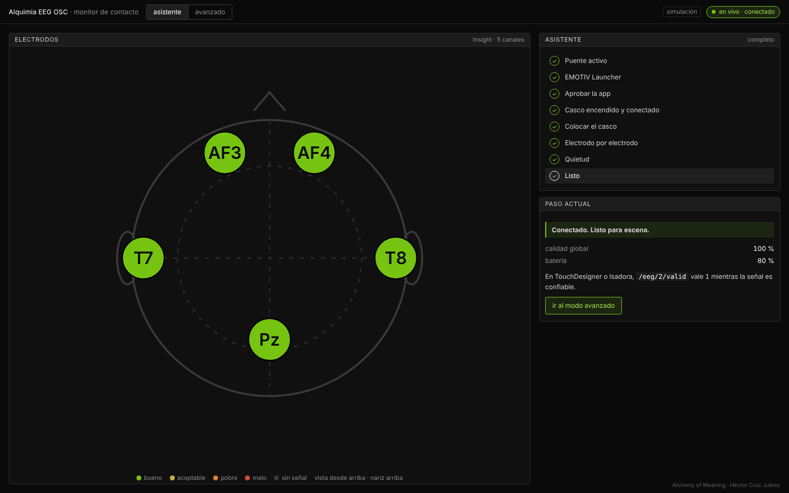
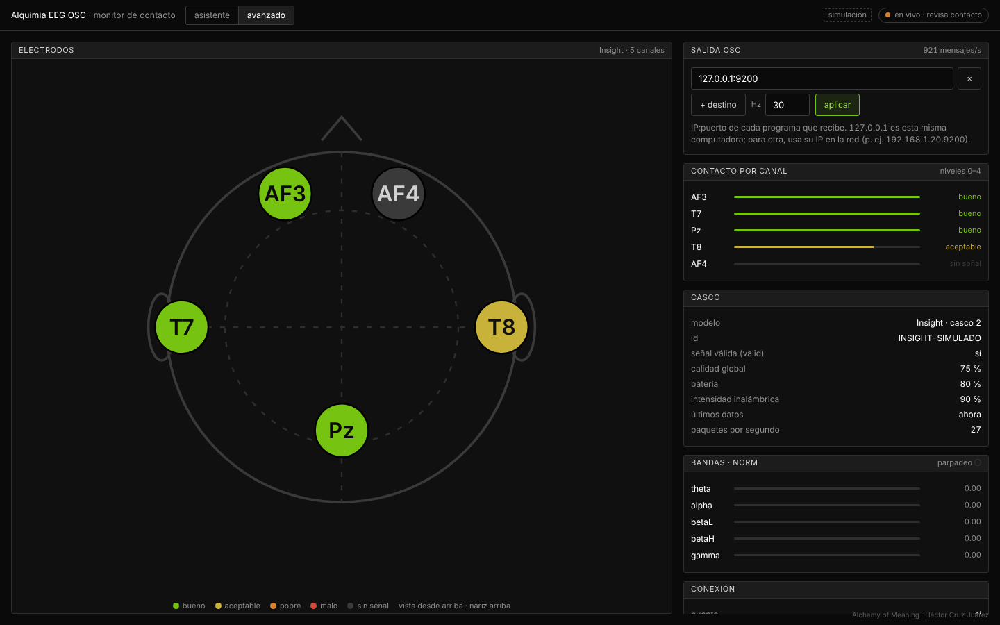
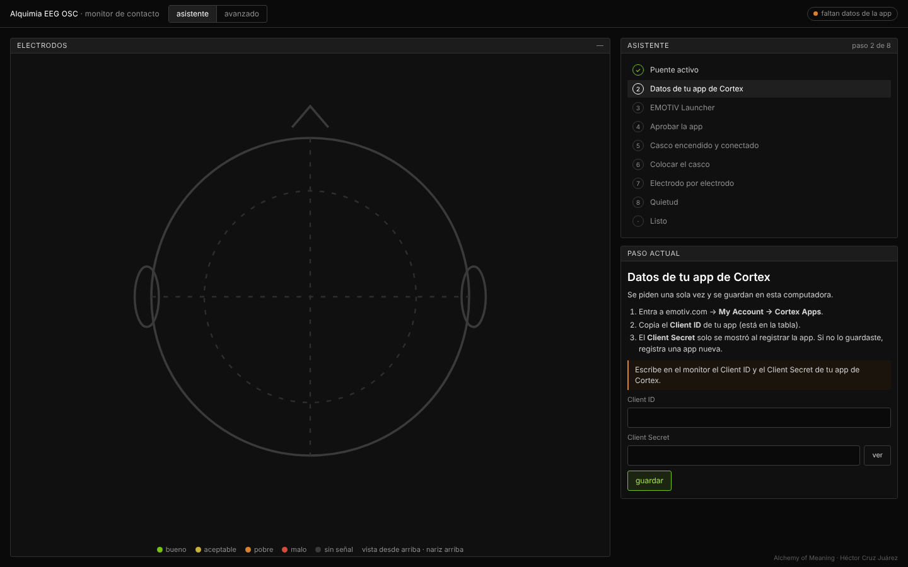
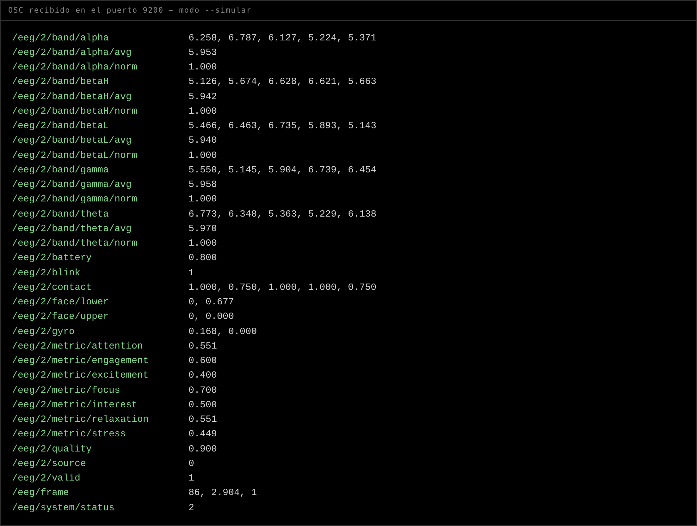

# Alquimia EEG OSC

**v0.3** · Puente entre cascos EEG Emotiv (Insight, EPOC+) y OSC para teatro, danza y música, con monitor de contacto.


*[English below](#english)*

## Qué es

Lee los datos de un casco Emotiv a través de **Cortex** (el servicio del EMOTIV Launcher): bandas de frecuencia, parpadeos y expresiones faciales, métricas de atención o relajación, giro de cabeza y calidad de contacto. Los suaviza, los normaliza de 0 a 1 y los envía por **OSC** a TouchDesigner, Isadora o cualquier programa que lo reciba.

Está pensado para escena: estados de un intérprete o de alguien del público que mueven un paisaje, una música o un cue, y también para grabar sesiones y analizar una obra escena por escena.

- **Monitor de contacto** en el navegador: la cabeza vista desde arriba, con cada electrodo en verde, amarillo, naranja, rojo o gris. Tiene un **asistente** paso a paso para colocar el casco y un **modo avanzado** con todos los datos.
- Salida a tasa fija, solo con números (sin texto), con `valid` y `quality` para saber cuándo confiar en la señal.
- Calibración automática por persona (`/norm`).
- Grabación y reproducción de sesiones, para ensayar sin casco y tener respaldo en función.
- Modo de simulación para armar el patch sin casco.

Especificación OSC completa: [docs/especificacion-osc.md](docs/especificacion-osc.md).

## Instalación paso a paso

### Opción A · Ejecutable (recomendado, sin instalar Python)

1. **EMOTIV Launcher:** descárgalo de https://www.emotiv.com/pages/download-emotiv-launcher (o en emotiv.com → My Account → Downloads → *Emotiv-Installer-Win*). Instálalo, ábrelo e inicia sesión con tu cuenta.
2. **Tu app de Cortex** (una sola vez): emotiv.com → **My Account → Cortex Apps → Register new**. Ponle nombre, deja **apagado** «Enable EEG for Professional devices» y registra. Guarda el **Client ID** y el **Client Secret**: el Secret solo se muestra una vez.
3. **Descarga el programa** desde **[Releases](https://github.com/loquellega/alquimia-eeg-osc/releases)**:
   - Windows: `AlquimiaEEGOSC-windows.exe`
   - Mac (Apple Silicon): `AlquimiaEEGOSC-mac.zip`
4. **Ábrelo con doble clic.** Se abre una ventana de texto (déjala abierta; es el puente) y el monitor en el navegador.
   - Windows puede avisar «Windows protegió su PC», porque el programa no está firmado: **Más información → Ejecutar de todas formas**.
   - Mac: clic derecho → **Abrir** la primera vez.
5. **En el monitor, pega el Client ID y el Client Secret** y pulsa *guardar*. Se guardan en tu computadora y no se vuelven a pedir.
6. **Aprueba la app** en el Launcher cuando lo pida (solo la primera vez).
7. Enciende el casco y **sigue el asistente** hasta que diga «Conectado. Listo para escena.»

Para cerrar, cierra la ventana de texto. Las grabaciones (`--grabar`) quedan junto al ejecutable.

### Opción B · Desde el código, con Python

1. **Python 3.12** de python.org. En Windows, marca **«Add python.exe to PATH»** al instalar. En Mac, usa `python3` y `pip3` en lugar de `python` y `pip`.
2. **Descarga el repo** (botón verde **Code → Download ZIP**) o clónalo: `git clone https://github.com/loquellega/alquimia-eeg-osc`
3. **Abre una terminal dentro de la carpeta** (en Windows: escribe `cmd` en la barra de direcciones de la carpeta; en Mac: clic derecho → *Nuevo Terminal en la carpeta*) y corre:
   ```
   pip install -r requirements.txt
   ```
4. Instala el **EMOTIV Launcher** y registra tu app de Cortex (pasos 1 y 2 de la opción A).
5. Prueba sin casco: `python cortex_osc.py --simular --monitor`
6. Con el casco: `python cortex_osc.py --monitor`. Pega tus datos en el monitor y sigue el asistente.

> Opcional: en lugar de escribirlos en el monitor, puedes poner `EMOTIV_CLIENT_ID` y `EMOTIV_CLIENT_SECRET` en un archivo `.env` (copia `.env.example`). El `.env` nunca se sube a GitHub.

### Dónde se guardan tus datos de Cortex
- Windows: `%APPDATA%\AlquimiaEEGOSC\config.json`
- Mac: `~/Library/Application Support/AlquimiaEEGOSC/config.json`
- Linux: `~/.config/AlquimiaEEGOSC/config.json`

Para cambiarlos, borra ese archivo y vuelve a abrir el programa.

## ¿Cómo sé que está conectado?

- En el monitor, la pastilla de arriba a la derecha dice **«en vivo · conectado»** en verde cuando todos los electrodos están en aceptable o bueno y la señal es confiable.
  - «en vivo · revisa contacto»: llegan datos, pero algún electrodo sigue en rojo o naranja.
  - «sin datos del casco» o «esperando Launcher»: falta un paso. El asistente te dice cuál.
- En TouchDesigner o Isadora, `/eeg/2/valid` vale **1** (o `/eeg/1/valid` con el EPOC+).
- En la terminal aparece «En vivo. Enviando OSC…».

## Monitor de contacto

| Modo | Para qué |
|---|---|
| **asistente** (tecla 1) | guía paso a paso: Launcher → aprobar la app → encender el casco → colocarlo → electrodo por electrodo (marca con un anillo el que falta y da pistas de dónde va) → quietud → listo |
| **avanzado** (tecla 2) | contacto por canal, batería, intensidad inalámbrica, calidad global, paquetes por segundo, bandas, parpadeo y estado de la conexión |

Colores: **verde** bueno · **amarillo** aceptable · **naranja** pobre · **rojo** malo · **gris** sin señal. Desde amarillo ya cuenta como conectado.

El monitor se abre en `http://localhost:9201` y usa también el puerto 9202. Con dos cascos aparece un selector arriba.

## Uso diario

| Opción | Qué hace |
|---|---|
| `--monitor` | abre el monitor de contacto (`--no-abrir` para no abrir el navegador solo). El ejecutable lo abre siempre con doble clic |
| `--simular` | datos sintéticos sin casco |
| `--grabar` | guarda la sesión en `grabaciones/eeg_FECHA.jsonl` |
| `--reproducir ARCHIVO` | reproduce una grabación (`--bucle` para repetir) |
| `--destino host:puerto` | destino OSC; se puede repetir. Por defecto `127.0.0.1:9200` |
| `--crudo` | EEG crudo en `/eeg/{casco}/raw` (cascos de consumo como el Insight) |
| `--casco INSIGHT` | usa solo el casco cuyo id contenga ese texto |
| `--hz 30` · `--suavizado 0.3` | tasa de salida · suavizado (más bajo = más suave) |

Ejemplo, en función: `python cortex_osc.py --monitor --grabar --destino 127.0.0.1:9200 --destino 192.168.1.20:9200`

**Recibir:** en TouchDesigner usa un OSC In CHOP en el puerto 9200. En Isadora, pon el puerto OSC en 9200 (Preferencias → Comunicaciones) y usa el actor OSC Listener.

**Cascos:** `/eeg/1/…` = EPOC+, `/eeg/2/…` = Insight.

**Nota:** con Cortex sin licencia de pago, los cascos de consumo (Insight) entregan todos los flujos, incluido el EEG crudo; los profesionales (EPOC) todo excepto el EEG crudo y las métricas de alta resolución. El EEG no lee emociones: da estimaciones de estado. Úsalas como textura escénica, no como verdad.

## Problemas comunes

| Mensaje | Qué hacer |
|---|---|
| «Esperando el EMOTIV Launcher…» | abre el Launcher e inicia sesión; el puente sigue solo |
| «Aprueba la app…» | acepta la solicitud en el Launcher |
| «Buscando el casco…» | enciéndelo, revisa la batería y el Bluetooth |
| «Cortex no aceptó los datos de la app» | revisa el Client ID y el Secret; el monitor te los vuelve a pedir |
| «Los puertos 9201 y 9202 están ocupados» | ya hay otro puente abierto: ciérralo |
| todos los electrodos en gris o rojo | revisa los sensores de referencia detrás de la oreja |

## Capturas / Screenshots

| | | |
|---|---|---|
|  |  |  |
| Asistente: electrodo por electrodo · *Wizard: electrode by electrode* | Asistente: conectado · *Wizard: connected* | Modo avanzado · *Advanced mode* |
|  |  |  |
| Asistente: datos de la app · *Wizard: Cortex app details* | Monitor en celular · *Monitor on a phone* | Conexión con Cortex · *Connecting to Cortex* |
|  | | |
| Mensajes OSC (simulación) · *OSC messages (simulation)* | | |

---

<a id="english"></a>
## English

**Alquimia EEG OSC** bridges Emotiv EEG headsets (Insight, EPOC+) to OSC for theatre, dance and music. It reads Cortex (EMOTIV Launcher) streams (band power, blinks and facial expressions, performance metrics, head motion and contact quality), smooths and normalises them to 0–1, and sends them over OSC to TouchDesigner, Isadora or any OSC client.

It includes a **contact monitor** in the browser: a top view of the head with each electrode coloured by contact quality, a step-by-step **wizard** to fit the headset, and an **advanced** view with all readings.

**Install:** download `AlquimiaEEGOSC-windows.exe` or `AlquimiaEEGOSC-mac.zip` from [Releases](https://github.com/loquellega/alquimia-eeg-osc/releases) and install the EMOTIV Launcher. Register a Cortex app (emotiv.com → My Account → Cortex Apps) and paste its Client ID and Secret into the monitor the first time. From source: Python 3.10+, `pip install -r requirements.txt`.

**Run:** double-click the executable (or `python cortex_osc.py --monitor`), approve the app in the Launcher the first time, and follow the wizard until it says it is connected. Use `--simular` to test without a headset, `--grabar` to record a session and `--reproducir FILE` to play it back. OSC goes to `127.0.0.1:9200` by default; `/eeg/{n}/valid` is 1 while the signal is reliable.

Full OSC specification (in Spanish): [docs/especificacion-osc.md](docs/especificacion-osc.md).

## Licencia / License

GPL-3.0-or-later. Ver [LICENSE](LICENSE).

## Créditos / Credits

Diseño, investigación y desarrollo: Héctor Cruz Juárez — https://hectorcruz.com.mx  
Colección Alchemy of Meaning.
