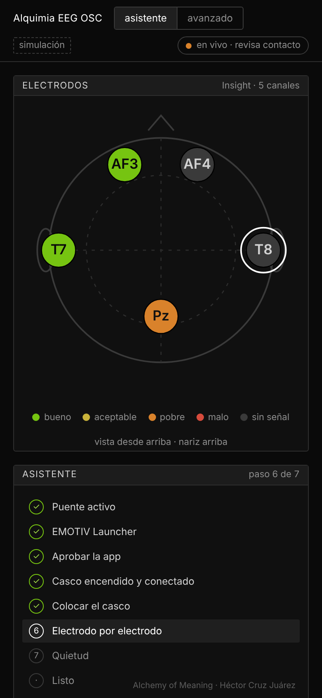
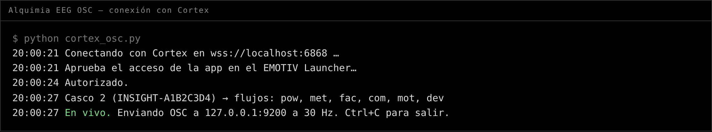

# Alquimia EEG OSC

**v0.2** · Puente entre cascos EEG Emotiv (Insight, EPOC+) y OSC para teatro, danza y música, con monitor de contacto.


*[English below](#english)*

## Qué es

Lee los datos de un casco Emotiv a través de **Cortex** (el servicio del EMOTIV Launcher): bandas de frecuencia, parpadeos y expresiones faciales, métricas de atención o relajación, giro de cabeza y calidad de contacto. Los suaviza, los normaliza de 0 a 1 y los envía por **OSC** a TouchDesigner, Isadora o cualquier programa que lo reciba.

Está pensado para escena: estados de un intérprete o de alguien del público que mueven un paisaje, una música o un cue, y también para grabar sesiones y analizar una obra escena por escena.

- **Monitor de contacto** en el navegador: la cabeza vista desde arriba, con cada electrodo en verde, amarillo, naranja, rojo o gris. Tiene un **asistente** paso a paso para colocar el casco y un **modo avanzado** con todos los datos.
- Salida a tasa fija, solo con números (sin texto), con `valid` y `quality` para saber cuándo confiar en la señal.
- Calibración automática por persona (`/norm`).
- Grabación y reproducción de sesiones, para ensayar sin casco y tener respaldo en función.
- Modo de simulación para armar el patch sin casco.

Especificación OSC completa: [docs/especificacion-osc.md](docs/especificacion-osc.md).

## Instalación paso a paso

### 1. Python
- **Windows:** descarga Python 3.12 de python.org. En el instalador, marca **«Add python.exe to PATH»**. Para comprobarlo, abre *Símbolo del sistema* y escribe `python --version`.
- **Mac:** descarga Python 3.12 de python.org e instálalo. Para comprobarlo, abre *Terminal* y escribe `python3 --version`. En Mac usa `python3` y `pip3` en lugar de `python` y `pip` en todos los pasos.

### 2. Este programa
- En GitHub: botón verde **Code → Download ZIP**, y descomprímelo donde quieras (por ejemplo, en Documentos).
- O con git: `git clone https://github.com/loquellega/alquimia-eeg-osc`

### 3. Dependencias
Abre la terminal **dentro de la carpeta** del programa. En Windows: abre la carpeta, escribe `cmd` en la barra de direcciones y pulsa Enter. En Mac: clic derecho en la carpeta → *Nuevo Terminal en la carpeta*. Luego:
```
pip install -r requirements.txt
```

### 4. Tu app de Cortex
1. Entra a emotiv.com → **My Account → Cortex Apps → Register new**.
2. Ponle nombre, deja **apagado** «Enable EEG for Professional devices» y registra.
3. Copia el **Client ID** y el **Client Secret**. El Secret solo se muestra una vez.
4. En la carpeta del programa, copia `.env.example` como `.env` y pega ahí los dos valores. El `.env` nunca se sube a GitHub.

> En Windows, el Explorador oculta las extensiones. Si no puedes nombrar el archivo `.env`, ábrelo con el Bloc de notas y usa *Guardar como*, con el nombre `".env"` (con comillas) y el tipo «Todos los archivos».

### 5. EMOTIV Launcher
Descárgalo de emotiv.com, instálalo y entra con tu cuenta. Déjalo abierto mientras usas el puente.

### 6. Primera prueba, sin casco
```
python cortex_osc.py --simular --monitor
```
Se abre el monitor en el navegador con un Insight simulado: verás cómo los electrodos pasan de gris a verde. Si quieres, abre TouchDesigner o Isadora y revisa que lleguen mensajes al puerto 9200. Ctrl+C para salir.

### 7. Con el casco
1. Carga el casco y enciéndelo (luz blanca). Activa el Bluetooth de la computadora.
2. Corre:
   ```
   python cortex_osc.py --monitor
   ```
3. La primera vez, el Launcher te pide **aprobar la app**. Apruébala.
4. Sigue el asistente del monitor hasta que diga **«Conectado. Listo para escena.»**

## ¿Cómo sé que está conectado?

- En el monitor, la pastilla de arriba a la derecha dice **«en vivo · conectado»** en verde cuando todos los electrodos están en aceptable o bueno y la señal es confiable.
  - «en vivo · revisa contacto»: llegan datos, pero algún electrodo sigue en rojo o naranja.
  - «sin datos del casco» o «esperando Launcher»: falta un paso. El asistente te dice cuál.
- En TouchDesigner o Isadora, `/eeg/2/valid` vale **1** (o `/eeg/1/valid` con el EPOC+).
- En la terminal aparece «En vivo. Enviando OSC…».

## Monitor de contacto

| Modo | Para qué |
|---|---|
| **asistente** (tecla 1) | guía paso a paso: Launcher → aprobar la app → encender el casco → colocarlo → electrodo por electrodo (marca con un anillo el que falta y da pistas de dónde va) → quietud → listo |
| **avanzado** (tecla 2) | contacto por canal, batería, intensidad inalámbrica, calidad global, paquetes por segundo, bandas, parpadeo y estado de la conexión |

Colores: **verde** bueno · **amarillo** aceptable · **naranja** pobre · **rojo** malo · **gris** sin señal. Desde amarillo ya cuenta como conectado.

El monitor se abre en `http://localhost:9201` y usa también el puerto 9202. Con dos cascos aparece un selector arriba.

## Uso diario

| Opción | Qué hace |
|---|---|
| `--monitor` | abre el monitor de contacto (`--no-abrir` para no abrir el navegador solo) |
| `--simular` | datos sintéticos sin casco |
| `--grabar` | guarda la sesión en `grabaciones/eeg_FECHA.jsonl` |
| `--reproducir ARCHIVO` | reproduce una grabación (`--bucle` para repetir) |
| `--destino host:puerto` | destino OSC; se puede repetir. Por defecto `127.0.0.1:9200` |
| `--crudo` | EEG crudo en `/eeg/{casco}/raw` (cascos de consumo como el Insight) |
| `--casco INSIGHT` | usa solo el casco cuyo id contenga ese texto |
| `--hz 30` · `--suavizado 0.3` | tasa de salida · suavizado (más bajo = más suave) |

Ejemplo, en función: `python cortex_osc.py --monitor --grabar --destino 127.0.0.1:9200 --destino 192.168.1.20:9200`

**Recibir:** en TouchDesigner usa un OSC In CHOP en el puerto 9200. En Isadora, pon el puerto OSC en 9200 (Preferencias → Comunicaciones) y usa el actor OSC Listener.

**Cascos:** `/eeg/1/…` = EPOC+, `/eeg/2/…` = Insight.

**Nota:** con Cortex sin licencia de pago, los cascos de consumo (Insight) entregan todos los flujos, incluido el EEG crudo; los profesionales (EPOC) todo excepto el EEG crudo y las métricas de alta resolución. El EEG no lee emociones: da estimaciones de estado. Úsalas como textura escénica, no como verdad.

## Problemas comunes

| Mensaje | Qué hacer |
|---|---|
| «Esperando el EMOTIV Launcher…» | abre el Launcher e inicia sesión; el puente sigue solo |
| «Aprueba la app…» | acepta la solicitud en el Launcher |
| «Buscando el casco…» | enciéndelo, revisa la batería y el Bluetooth |
| «No se pudo autorizar» | revisa el Client ID y el Secret en el `.env` |
| «Los puertos 9201 y 9202 están ocupados» | ya hay otro puente abierto: ciérralo |
| todos los electrodos en gris o rojo | revisa los sensores de referencia detrás de la oreja |

## Capturas / Screenshots

| | | |
|---|---|---|
|  |  |  |
| Asistente: electrodo por electrodo · *Wizard: electrode by electrode* | Asistente: conectado · *Wizard: connected* | Modo avanzado · *Advanced mode* |
|  |  |  |
| Monitor en celular · *Monitor on a phone* | Conexión con Cortex · *Connecting to Cortex* | Mensajes OSC (simulación) · *OSC messages (simulation)* |

---

<a id="english"></a>
## English

**Alquimia EEG OSC** bridges Emotiv EEG headsets (Insight, EPOC+) to OSC for theatre, dance and music. It reads Cortex (EMOTIV Launcher) streams (band power, blinks and facial expressions, performance metrics, head motion and contact quality), smooths and normalises them to 0–1, and sends them over OSC to TouchDesigner, Isadora or any OSC client.

It includes a **contact monitor** in the browser: a top view of the head with each electrode coloured by contact quality, a step-by-step **wizard** to fit the headset, and an **advanced** view with all readings.

**Install:** Python 3.10+, `pip install -r requirements.txt`, copy `.env.example` to `.env` with your Cortex app Client ID and Secret (emotiv.com → My Account → Cortex Apps), and install the EMOTIV Launcher.

**Run:** `python cortex_osc.py --monitor`, approve the app in the Launcher the first time, and follow the wizard until it says it is connected. Use `--simular` to test without a headset, `--grabar` to record a session and `--reproducir FILE` to play it back. OSC goes to `127.0.0.1:9200` by default; `/eeg/{n}/valid` is 1 while the signal is reliable.

Full OSC specification (in Spanish): [docs/especificacion-osc.md](docs/especificacion-osc.md).

## Licencia / License

GPL-3.0-or-later. Ver [LICENSE](LICENSE).

## Créditos / Credits

Diseño, investigación y desarrollo: Héctor Cruz Juárez — https://hectorcruz.com.mx  
Colección Alchemy of Meaning.
